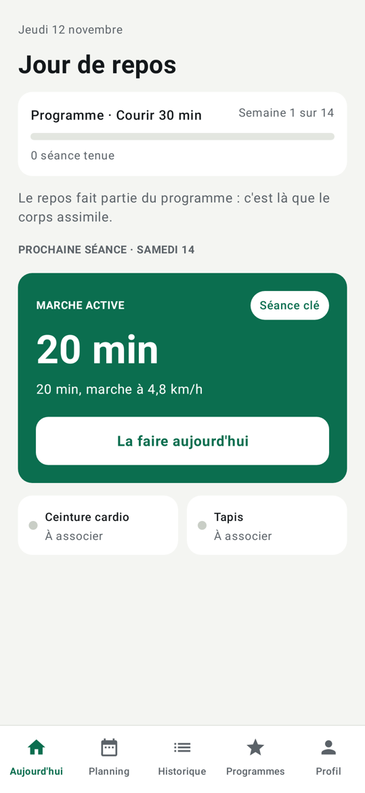
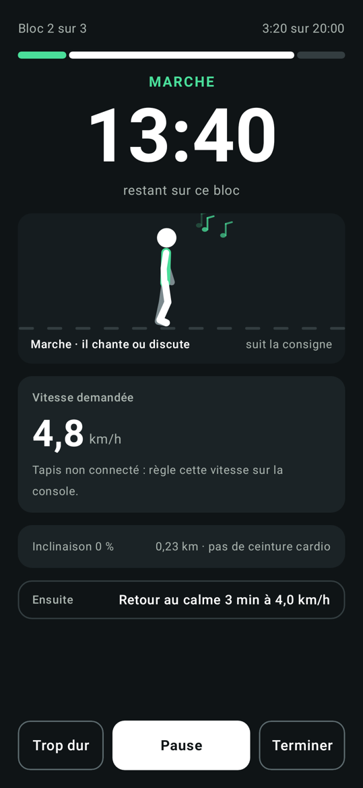
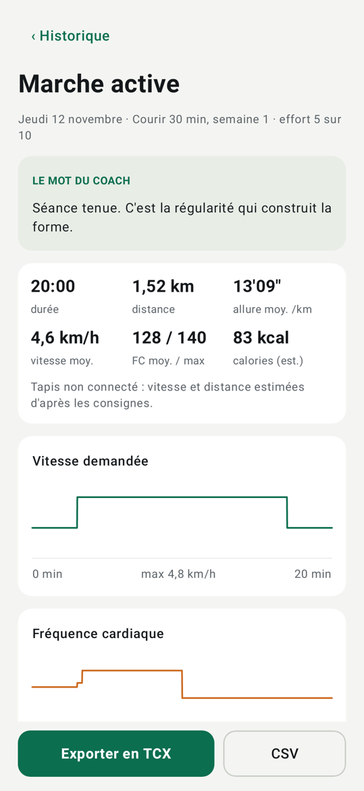
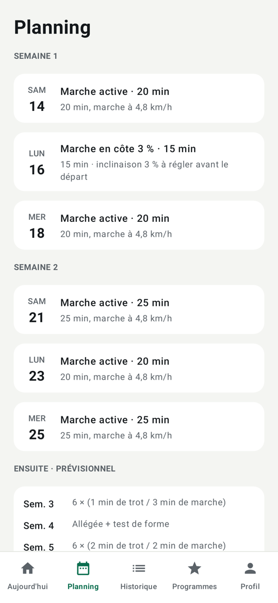
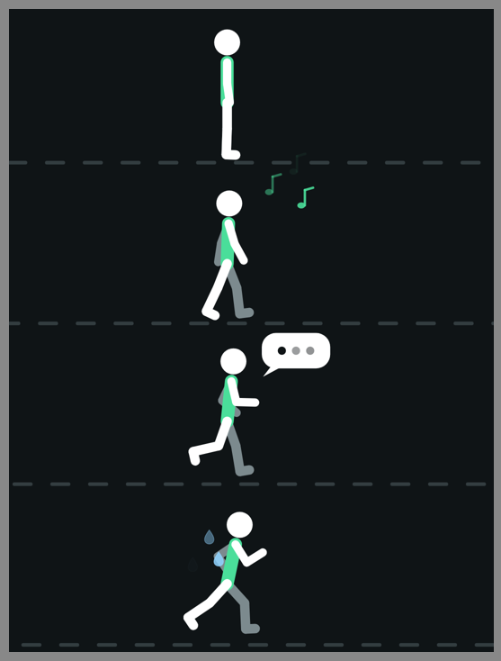

# Relance

App Android de remise au sport sur tapis de course : un coach qui s'adapte à ton emploi du temps et à ta condition physique de départ.

## Installer l'app

**[Télécharger l'APK (relance.apk)](apk/relance.apk?raw=true)** — version 0.9.0, Android 8 ou plus récent.

1. Ouvre ce lien depuis le téléphone, ou copie le fichier `apk/relance.apk` dessus.
2. Ouvre le fichier et accepte l'installation depuis cette source (Android le demande pour toute app hors Play Store).
3. Lance « Relance » et fais le bilan de départ.

Les données restent sur le téléphone : pas de compte, pas de serveur. Elles n'en sortent que si tu les exportes ou actives Santé Connect.

| Aujourd'hui | Séance guidée | Fiche de séance | Planning |
|---|---|---|---|
|  |  |  |  |

Le coureur animé, à l'arrêt, en marche, au trot et en course rapide :



## Ce que fait cette version

- **Bilan de départ** : questions de santé, profil, zones sensibles, test de marche, jours et durée disponibles.
- **Niveau au choix** : avant chaque programme, le sportif choisit son niveau (N1 à N4) parmi ceux que le programme propose ; son niveau évalué est présélectionné.
- **Vitesse de référence** : modifiable à la main dans le profil, ou en relançant le test de marche de 12 min ; le test hors programme ne fait pas avancer le programme.
- **Programmes sur mesure** : courir 10 min, 30 min, 45 min, 1 h, 5 km, 10 km, améliorer ses performances, santé et forme. Un seul programme à la fois, avec pause, arrêt et liste des programmes effectués.
- **Planning** : toutes les semaines jusqu'à l'objectif, à déplier une par une ; chaque séance s'ouvre sur son détail bloc par bloc (durées, vitesses, inclinaison, distance et calories estimées). Une semaine allégée sur quatre avec test de forme. Un palier se valide après 2 séances clés : à 1 séance par semaine, le programme est deux fois plus long ; à 2, 3 ou 4 séances, sa durée ne change pas et les séances en plus sont de l'endurance. Une séance manquée glisse, elle n'est jamais doublée.
- **Séance en avance** : la prochaine séance peut se faire avant sa date ; les suivantes avancent d'autant.
- **Annuler une séance** depuis sa fiche : la dernière séance du programme est annulée « pour la refaire » (le programme revient à son état d'avant et elle redevient la prochaine séance) ; une séance plus ancienne est seulement retirée de l'historique.
- **Séance guidée** : compte à rebours par bloc, vitesse à régler, annonces vocales, version courte « je n'ai que 15 min », bouton « trop dur ».
- **Coureur animé** : il suit la vitesse du tapis (ou la consigne), chante en marchant, parle en trottinant, transpire quand ça va vite.
- **Séance faite sans le téléphone** : bouton « Je l'ai faite sans le téléphone » sur l'écran Aujourd'hui. On indique le jour (jusqu'à 7 jours en arrière), le moment, la durée, la distance si on la connaît et le ressenti ; le programme avance comme après une séance guidée. Distance et calories sont alors estimées d'après la séance prévue.
- **Adaptation** : l'effort ressenti, une douleur ou une séance écourtée modifient la suite du programme ; une coupure de deux semaines fait reculer de deux paliers.
- **Historique** : statistiques par séance (durée, distance, allure, cardio et zones, calories estimées), courbes, cumuls et records.
- **Export** : chaque séance en TCX (accepté par Strava et Garmin Connect) ou en CSV.
- **Santé Connect** : chaque séance est écrite dans Santé Connect (exercice sur tapis, distance, calories actives estimées, vitesse, fréquence cardiaque) pour apparaître dans Google Health et les autres apps de santé. Envoi automatique après chaque séance, envoi de l'historique en un geste, depuis Profil › Santé Connect. Relance écrit seulement, elle ne lit rien.
- **Capteurs Bluetooth** : ceinture cardio standard, et tapis ou boîtier ESP32 parlant FTMS, en lecture seule.
- **Fréquence cardiaque de repos** : bouton « Mesurer avec ma ceinture » dans le profil. Assis, 2 minutes d'écoute, puis la valeur est enregistrée et les zones cardiaques recalculées.
- **Étalonnage du boîtier** : trois paliers de marche, bande à vide, pour caler la vitesse mesurée sur celle de la console.

## Interface coach

Les programmes ne sont plus figés dans l'app : un coach les construit et les publie depuis une interface web hébergée sur Netlify, **https://relance-coach.netlify.app** (code dans [`web/`](web/README.md)). L'app récupère le catalogue publié une fois par jour, ou tout de suite avec **Programmes → Mettre à jour les programmes**, et l'adapte au profil enregistré sur le téléphone. Un programme en cours garde sa version ; si le coach la modifie, l'app propose de l'appliquer, au plus tôt au début de la semaine suivante.

Le catalogue initial (`catalog/catalog.json`) reprend les programmes de la première version et sert hors ligne.

Un programme peut aussi être **importé depuis un fichier JSON**, par exemple généré par un agent Claude ou ChatGPT : voir le [contrat d'import](contract/README.md) et le [guide pour l'agent](contract/AGENT.md).

## Boîtier pour Domyos Run100

Le Run100 classique n'est pas connecté : un boîtier ESP32 (environ 20 €) compte les tours d'un rouleau grâce à un aimant et un capteur à effet Hall, et envoie vitesse et distance à l'app.

- [Guide de montage](docs/MONTAGE.md) : liste d'achat, câblage, pose, mise en service.
- [Programme du boîtier](firmware/README.md) : à charger une fois dans l'ESP32 avec PlatformIO.

## Ce qui n'y est pas encore

- Envoi automatique vers Strava (l'export TCX s'importe à la main sur strava.com) et vers Decathlon Coach.
- Export au format FIT.
- Rappels par notification.
- Mesure de l'inclinaison par le boîtier (l'app utilise l'inclinaison prévue par la séance).

## État des vérifications

L'app a été construite et testée sans téléphone ni émulateur :

- le moteur de coaching, l'export, l'étalonnage et le décodage Bluetooth sont couverts par 40 tests unitaires, et la conversion d'une séance pour Santé Connect par 2 autres ;
- le programme du boîtier compile pour ESP32 et sa logique de mesure passe 7 tests ; une trame qu'il produit est décodée par l'app dans les tests ;
- des tests parcourent toute l'interface (bilan de départ, séance, bilan, fiche, arrêt de programme, étalonnage, mesure de la FC de repos, carte Santé Connect, saisie d'une séance faite sans le téléphone, planning détaillé, séance faite en avance puis annulée et refaite) et produisent les captures ci-dessus.

**Non vérifié sur un vrai appareil** : l'envoi réel vers Santé Connect et l'affichage dans Google Health, le boîtier monté sur un vrai tapis, la connexion Bluetooth à une ceinture ou au boîtier, les annonces vocales, l'enregistrement du fichier d'export, et le comportement quand l'app passe en arrière-plan pendant une séance (garde l'écran de séance ouvert : il reste allumé).

## Construire l'APK

Il faut le SDK Android (plateforme 36) et un JDK 17 ou plus récent.

```bash
./gradlew :app:testDebugUnitTest   # tests, captures dans app/build/shots
./gradlew :app:assembleRelease     # APK dans app/build/outputs/apk/release
```

L'APK est signé avec une clé de développement versionnée (`app/relance-dev.keystore`), pour que chaque version s'installe par-dessus la précédente. Elle n'a rien de secret : à remplacer par une clé privée avant toute diffusion publique.

## Documentation

- [Concept détaillé](docs/CONCEPT.md) : logique de coach, programmes, capteurs, feuille de route.

Relance donne des conseils d'entraînement, pas un avis médical.
